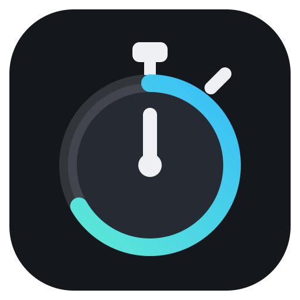
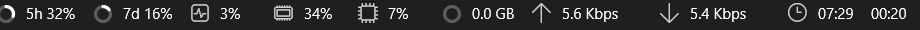
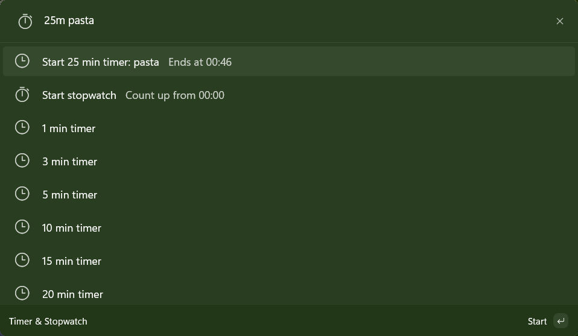
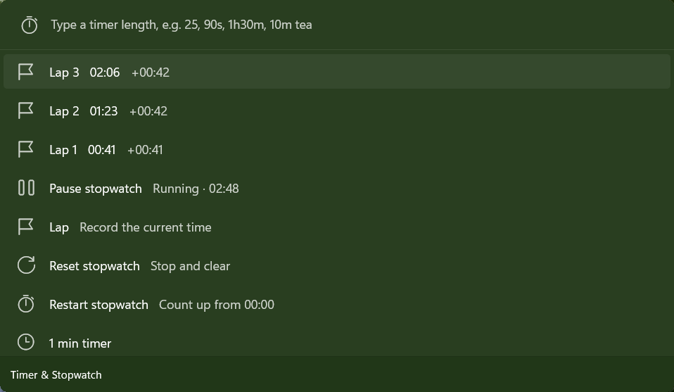

<p align="center">
  
</p>

<h1 align="center">Timer Dock</h1>

<p align="center">
  A timer and stopwatch on the PowerToys Command Palette Dock, always in view without a window in the way.
</p>

<p align="center">
  
</p>

## Features

- **Countdown timer of any length.** Type `25`, `90s`, `1h30m` or `1:30`, with an optional label (`10m tea`), or pick a preset from 1 to 90 minutes.
- **Stopwatch with laps**, each showing its total time and the split since the previous lap.
- **On the Dock all the time.** It counts up for the stopwatch and down for a timer. When idle it's just a small stopwatch icon.
- **Tells you when time's up**, with a Windows notification that stays until you dismiss it, and "Time's up" on the Dock.
- **Pause, resume, add a minute or five, or reset** from the same page.
- **Survives restarts.** A running timer keeps time if Command Palette or PowerToys restarts. If it ends while PowerToys is closed, the Dock shows "Time's up" when it's back.
- **Private and offline**: no network access, no accounts, no telemetry.

## Install

Requires Windows 10/11 and [PowerToys](https://github.com/microsoft/PowerToys) 0.102 or later with Command Palette and its Dock enabled.

**Microsoft Store**: coming soon. Until then, install it from GitHub (below).

Then right-click the Dock, choose **Edit**, and add the **Timer & Stopwatch** band.

<details>
<summary>Install from GitHub instead</summary>

In PowerShell:

```powershell
irm https://raw.githubusercontent.com/Arihant25/timer-dock/main/install.ps1 | iex
```

The script downloads the latest release for your CPU (x64 or ARM64), trusts its signing certificate (a single UAC prompt, because this build is self-signed) and installs it.

Install one or the other, not both: the Store and GitHub builds are separate apps.

To install by hand:

1. Download `TimerDock_<version>_<x64|arm64>.msix` and `TimerDock.cer` from [Releases](https://github.com/Arihant25/timer-dock/releases/latest).
2. In an elevated PowerShell: `Import-Certificate -FilePath TimerDock.cer -CertStoreLocation Cert:\LocalMachine\TrustedPeople`
3. Double-click the `.msix`, or run `Add-AppxPackage <file>.msix`.

</details>

## Usage

Click the timer on the Dock (or run **Timer & Stopwatch** from Command Palette) to open its page.

<p align="center">
  
</p>

| To | Do this |
|---|---|
| Start a timer | Type a length and press Enter, or pick a preset |
| Name a timer | Add a label after the length: `25m pasta`, `1:30 plank` |
| Start a stopwatch | Pick **Start stopwatch** |
| Record a lap | Pick **Lap** while the stopwatch runs. Laps show at the top, newest first |
| Pause or resume | Pick **Pause** / **Resume** |
| Add time | Pick **Add 1 min** or **Add 5 min**, even after the timer has finished |
| Clear it | Pick **Reset**, or **Dismiss** once a timer has finished |

<p align="center">
  
</p>

Lengths it understands: `25` (minutes), `2.5`, `90s`, `45 seconds`, `5 min`, `1h`, `1h30m`, `1h30`, `3m20s`, `1:30` (minutes:seconds), `1:00:00`. Up to 99 hours.

## Good to know

- One timer or stopwatch at a time. Starting a new one replaces the current one.
- The notification uses Windows' reminder style. If notifications are turned off for Timer Dock, it plays the Windows alarm sound instead. With Do Not Disturb on, Windows keeps the notification silent in the notification center; the Dock still shows "Time's up".
- The state (including laps) is saved in the app's own data folder and removed when you uninstall it.

## Building

Requires the .NET 10 SDK. No Windows SDK install is needed; `pack.ps1` uses the build tools from NuGet.

```powershell
./pack.ps1 -SelfSign -Install            # build, sign with a local dev cert, install (x64)
./pack.ps1 -Version 1.0.0.0 -Platform arm64 -SelfSign
./pack.ps1 -Version 1.0.0.0 -Store       # unsigned Store upload (x64 + ARM64 bundle)
```

## License

[MIT](LICENSE). Not affiliated with Microsoft.
